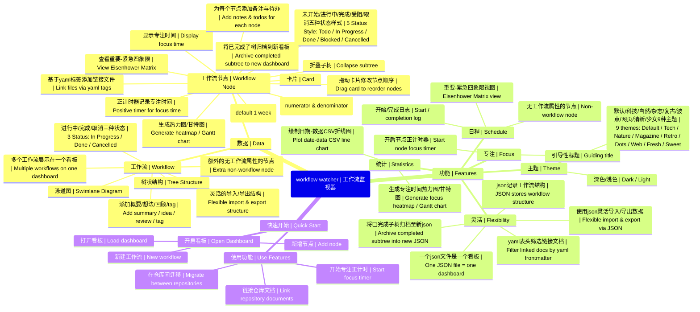

# workflow watcher 
**ZH ver**
- 基于工作流的obsidian文件看板 
- 工作流修改灵活，适合探索性任务
- 重视数据统计与复盘，开启正计时器 
- 绘制日期-数据折线图
- 9种主题，随心情切换
- 依靠json存储，无忧迁移

**EN ver**
- Workflow-based Obsidian file dashboard
- Workflow is flexible to modify, suitable for exploratory tasks
- Focus on data statistics and review, with positive timer available
- Plot date-data line chart
- 9 themes to switch according to your mood
- Data stored in JSON, hassle-free migration

**Board**

**Menu**

# README.md content

# goto README.md (a lot of pictures) 
[learn_more](./READMEinside.md)