# workflow watcher 
**ZH ver**
- 基于工作流的obsidian文件看板 
- 工作流修改灵活，适合探索性任务
- 重视数据统计与复盘，开启正计时器 
- 绘制日期-数据折线图
- 9种主题，随心情切换
- 依靠json存储，无忧迁移

**EN ver**
- Workflow-based Obsidian file dashboard
- Workflow is flexible to modify, suitable for exploratory tasks
- Focus on data statistics and review, with positive timer available
- Plot date-data line chart
- 9 themes to switch according to your mood
- Data stored in JSON, hassle-free migration

**Board**

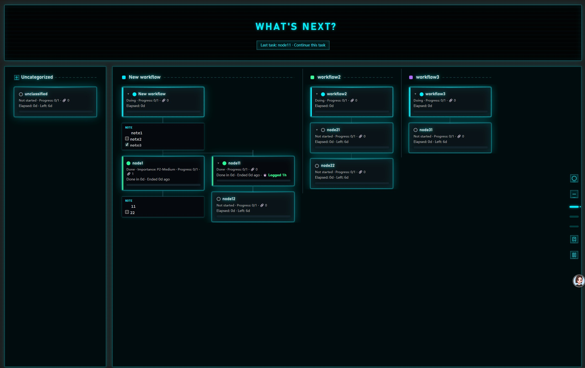

**Menu**

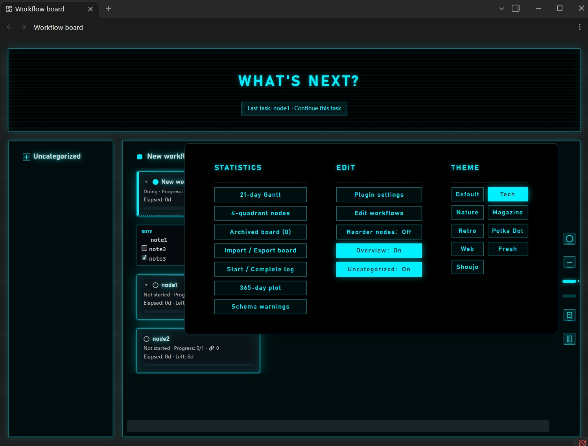

# README.md content

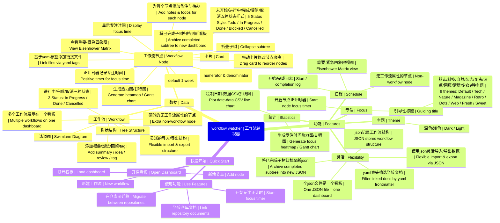

- [数据 | Data](#%E6%95%B0%E6%8D%AE--data)
  - [工作流 | Workflow](#%E5%B7%A5%E4%BD%9C%E6%B5%81--workflow)
    - [树状结构 | Tree Structure](#%E6%A0%91%E7%8A%B6%E7%BB%93%E6%9E%84--tree-structure)
    - [泳道图 | Swimlane Diagram](#%E6%B3%B3%E9%81%93%E5%9B%BE--swimlane-diagram)
    - [进行中/完成/取消三种状态 | 3 Status: In Progress / Done / Cancelled](#%E8%BF%9B%E8%A1%8C%E4%B8%AD%E5%AE%8C%E6%88%90%E5%8F%96%E6%B6%88%E4%B8%89%E7%A7%8D%E7%8A%B6%E6%80%81--3-status-in-progress--done--cancelled)
    - [多个工作流展示在一个看板 | Multiple workflows on one dashboard](#%E5%A4%9A%E4%B8%AA%E5%B7%A5%E4%BD%9C%E6%B5%81%E5%B1%95%E7%A4%BA%E5%9C%A8%E4%B8%80%E4%B8%AA%E7%9C%8B%E6%9D%BF--multiple-workflows-on-one-dashboard)
    - [灵活的导入/导出结构 | Flexible import & export structure](#%E7%81%B5%E6%B4%BB%E7%9A%84%E5%AF%BC%E5%85%A5%E5%AF%BC%E5%87%BA%E7%BB%93%E6%9E%84--flexible-import--export-structure)
    - [额外的无工作流属性的节点 | Extra non-workflow node](#%E9%A2%9D%E5%A4%96%E7%9A%84%E6%97%A0%E5%B7%A5%E4%BD%9C%E6%B5%81%E5%B1%9E%E6%80%A7%E7%9A%84%E8%8A%82%E7%82%B9--extra-non-workflow-node)
    - [添加概要/想法/回顾/tag | Add summary / idea / review / tag](#%E6%B7%BB%E5%8A%A0%E6%A6%82%E8%A6%81%E6%83%B3%E6%B3%95%E5%9B%9E%E9%A1%BEtag--add-summary--idea--review--tag)
  - [工作流节点 | Workflow Node](#%E5%B7%A5%E4%BD%9C%E6%B5%81%E8%8A%82%E7%82%B9--workflow-node)
    - [卡片 | Card](#%E5%8D%A1%E7%89%87--card)
    - [未开始/进行中/完成/受阻/取消五种状态样式 | 5 Status Style: Todo / In Progress / Done / Blocked / Cancelled](#%E6%9C%AA%E5%BC%80%E5%A7%8B%E8%BF%9B%E8%A1%8C%E4%B8%AD%E5%AE%8C%E6%88%90%E5%8F%97%E9%98%BB%E5%8F%96%E6%B6%88%E4%BA%94%E7%A7%8D%E7%8A%B6%E6%80%81%E6%A0%B7%E5%BC%8F--5-status-style-todo--in-progress--done--blocked--cancelled)
    - [折叠子树 | Collapse subtree](#%E6%8A%98%E5%8F%A0%E5%AD%90%E6%A0%91--collapse-subtree)
    - [进度条（填写分子与分母） | Progress bar (numerator & denominator)](#%E8%BF%9B%E5%BA%A6%E6%9D%A1%E5%A1%AB%E5%86%99%E5%88%86%E5%AD%90%E4%B8%8E%E5%88%86%E6%AF%8D--progress-bar-numerator--denominator)
    - [自动填写开始与截止日期（默认一周） | Auto fill start & due date (default 1 week)](#%E8%87%AA%E5%8A%A8%E5%A1%AB%E5%86%99%E5%BC%80%E5%A7%8B%E4%B8%8E%E6%88%AA%E6%AD%A2%E6%97%A5%E6%9C%9F%E9%BB%98%E8%AE%A4%E4%B8%80%E5%91%A8--auto-fill-start--due-date-default-1-week)
    - [基于yaml标签添加链接文件 | Link files via yaml tags](#%E5%9F%BA%E4%BA%8Eyaml%E6%A0%87%E7%AD%BE%E6%B7%BB%E5%8A%A0%E9%93%BE%E6%8E%A5%E6%96%87%E4%BB%B6--link-files-via-yaml-tags)
    - [正计时器记录专注时间 | Positive timer for focus time](#%E6%AD%A3%E8%AE%A1%E6%97%B6%E5%99%A8%E8%AE%B0%E5%BD%95%E4%B8%93%E6%B3%A8%E6%97%B6%E9%97%B4--positive-timer-for-focus-time)
    - [显示专注时间 | Display focus time](#%E6%98%BE%E7%A4%BA%E4%B8%93%E6%B3%A8%E6%97%B6%E9%97%B4--display-focus-time)
    - [生成热力图/甘特图 | Generate heatmap / Gantt chart](#%E7%94%9F%E6%88%90%E7%83%AD%E5%8A%9B%E5%9B%BE%E7%94%98%E7%89%B9%E5%9B%BE--generate-heatmap--gantt-chart)
    - [查看重要-紧急四象限 | View Eisenhower Matrix](#%E6%9F%A5%E7%9C%8B%E9%87%8D%E8%A6%81-%E7%B4%A7%E6%80%A5%E5%9B%9B%E8%B1%A1%E9%99%90--view-eisenhower-matrix)
    - [为每个节点添加备注与待办 | Add notes & todos for each node](#%E4%B8%BA%E6%AF%8F%E4%B8%AA%E8%8A%82%E7%82%B9%E6%B7%BB%E5%8A%A0%E5%A4%87%E6%B3%A8%E4%B8%8E%E5%BE%85%E5%8A%9E--add-notes--todos-for-each-node)
    - [将已完成子树归档到新看板 | Archive completed subtree to new dashboard](#%E5%B0%86%E5%B7%B2%E5%AE%8C%E6%88%90%E5%AD%90%E6%A0%91%E5%BD%92%E6%A1%A3%E5%88%B0%E6%96%B0%E7%9C%8B%E6%9D%BF--archive-completed-subtree-to-new-dashboard)
    - [拖动卡片修改节点顺序 | Drag card to reorder nodes](#%E6%8B%96%E5%8A%A8%E5%8D%A1%E7%89%87%E4%BF%AE%E6%94%B9%E8%8A%82%E7%82%B9%E9%A1%BA%E5%BA%8F--drag-card-to-reorder-nodes)
- [功能 | Features](#%E5%8A%9F%E8%83%BD--features)
  - [主题 | Theme](#%E4%B8%BB%E9%A2%98--theme)
    - [深色/浅色 | Dark / Light](#%E6%B7%B1%E8%89%B2%E6%B5%85%E8%89%B2--dark--light)
    - [默认/科技/自然/杂志/复古/波点/网页/清新/少女9种主题 | 9 themes: Default / Tech / Nature / Magazine / Retro / Dots / Web / Fresh / Sweet](#%E9%BB%98%E8%AE%A4%E7%A7%91%E6%8A%80%E8%87%AA%E7%84%B6%E6%9D%82%E5%BF%97%E5%A4%8D%E5%8F%A4%E6%B3%A2%E7%82%B9%E7%BD%91%E9%A1%B5%E6%B8%85%E6%96%B0%E5%B0%91%E5%A5%B39%E7%A7%8D%E4%B8%BB%E9%A2%98--9-themes-default--tech--nature--magazine--retro--dots--web--fresh--sweet)
  - [灵活 | Flexibility](#%E7%81%B5%E6%B4%BB--flexibility)
    - [json记录工作流结构 | JSON stores workflow structure](#json%E8%AE%B0%E5%BD%95%E5%B7%A5%E4%BD%9C%E6%B5%81%E7%BB%93%E6%9E%84--json-stores-workflow-structure)
    - [yaml表头筛选链接文档 | Filter linked docs by yaml frontmatter](#%E5%9F%BA%E4%BA%8Eyaml%E6%A0%87%E7%AD%BE%E6%B7%BB%E5%8A%A0%E9%93%BE%E6%8E%A5%E6%96%87%E4%BB%B6--link-files-via-yaml-tags)
    - [一个json文件是一个看板 | One JSON file = one dashboard](#%E4%B8%80%E4%B8%AAjson%E6%96%87%E4%BB%B6%E6%98%AF%E4%B8%80%E4%B8%AA%E7%9C%8B%E6%9D%BF--one-json-file--one-dashboard)
    - [使用json灵活导入/导出数据 | Flexible import & export via JSON](#%E7%81%B5%E6%B4%BB%E7%9A%84%E5%AF%BC%E5%85%A5%E5%AF%BC%E5%87%BA%E7%BB%93%E6%9E%84--flexible-import--export-structure)
    - [将已完成子树归档至新json | Archive completed subtree into new JSON](#%E5%B0%86%E5%B7%B2%E5%AE%8C%E6%88%90%E5%AD%90%E6%A0%91%E5%BD%92%E6%A1%A3%E5%88%B0%E6%96%B0%E7%9C%8B%E6%9D%BF--archive-completed-subtree-to-new-dashboard)
  - [专注 | Focus](#%E4%B8%93%E6%B3%A8--focus)
    - [引导性标题 | Guiding title](#%E5%BC%95%E5%AF%BC%E6%80%A7%E6%A0%87%E9%A2%98--guiding-title)
    - [开启节点正计时器 | Start node focus timer](#%E6%AD%A3%E8%AE%A1%E6%97%B6%E5%99%A8%E8%AE%B0%E5%BD%95%E4%B8%93%E6%B3%A8%E6%97%B6%E9%97%B4--positive-timer-for-focus-time)
  - [日程 | Schedule](#%E6%97%A5%E7%A8%8B--schedule)
    - [重要-紧急四象限视图 | Eisenhower Matrix view](#%E9%87%8D%E8%A6%81-%E7%B4%A7%E6%80%A5%E5%9B%9B%E8%B1%A1%E9%99%90%E8%A7%86%E5%9B%BE--eisenhower-matrix-view)
    - [开始/完成日志 | Start / completion log](#%E5%BC%80%E5%A7%8B%E5%AE%8C%E6%88%90%E6%97%A5%E5%BF%97--start--completion-log)
    - [无工作流属性的节点 | Non-workflow node](#%E9%A2%9D%E5%A4%96%E7%9A%84%E6%97%A0%E5%B7%A5%E4%BD%9C%E6%B5%81%E5%B1%9E%E6%80%A7%E7%9A%84%E8%8A%82%E7%82%B9--extra-non-workflow-node)
  - [统计 | Statistics](#%E7%BB%9F%E8%AE%A1--statistics)
    - [生成专注时间热力图/甘特图 | Generate focus heatmap / Gantt chart](#%E7%94%9F%E6%88%90%E7%83%AD%E5%8A%9B%E5%9B%BE%E7%94%98%E7%89%B9%E5%9B%BE--generate-heatmap--gantt-chart)
    - [绘制日期-数据CSV折线图 | Plot date-data CSV line chart](#%E7%BB%98%E5%88%B6%E6%97%A5%E6%9C%9F%E6%95%B0%E6%8D%AEcsv%E6%8A%98%E7%BA%BF%E5%9B%BE--plot-date-data-csv-line-chart)
- [快速开始 | Quick Start](#%E5%BF%AB%E9%80%9F%E5%BC%80%E5%A7%8B--quick-start)
  - [开启看板 | Open Dashboard](#%E5%BC%80%E5%90%AF%E7%9C%8B%E6%9D%BF--open-dashboard)
    - [打开看板 | Load dashboard](#%E6%89%93%E5%BC%80%E7%9C%8B%E6%9D%BF--load-dashboard)
    - [新建工作流 | New workflow](#%E6%96%B0%E5%BB%BA%E5%B7%A5%E4%BD%9C%E6%B5%81--new-workflow)
    - [新增节点 | Add node](#%E6%96%B0%E5%A2%9E%E8%8A%82%E7%82%B9--add-node)
  - [使用功能 | Use Features](#%E4%BD%BF%E7%94%A8%E5%8A%9F%E8%83%BD--use-features)
    - [链接仓库文档 | Link repository documents](#%E5%9F%BA%E4%BA%8Eyaml%E6%A0%87%E7%AD%BE%E6%B7%BB%E5%8A%A0%E9%93%BE%E6%8E%A5%E6%96%87%E4%BB%B6--link-files-via-yaml-tags)
    - [开始专注正计时 | Start focus timer](#%E6%AD%A3%E8%AE%A1%E6%97%B6%E5%99%A8%E8%AE%B0%E5%BD%95%E4%B8%93%E6%B3%A8%E6%97%B6%E9%97%B4--positive-timer-for-focus-time)
    - [在仓库间迁移 | Migrate between repositories](#%E7%81%B5%E6%B4%BB%E7%9A%84%E5%AF%BC%E5%85%A5%E5%AF%BC%E5%87%BA%E7%BB%93%E6%9E%84--flexible-import--export-structure)

## 数据 | Data

### 工作流 | Workflow

#### 树状结构 | Tree Structure

支持以树状结构组织管理整套工作流任务，层级清晰，支持多级子节点。

Supports organizing full workflow tasks in tree structure with clear hierarchy and multi-level child nodes.

#### 泳道图 | Swimlane Diagram

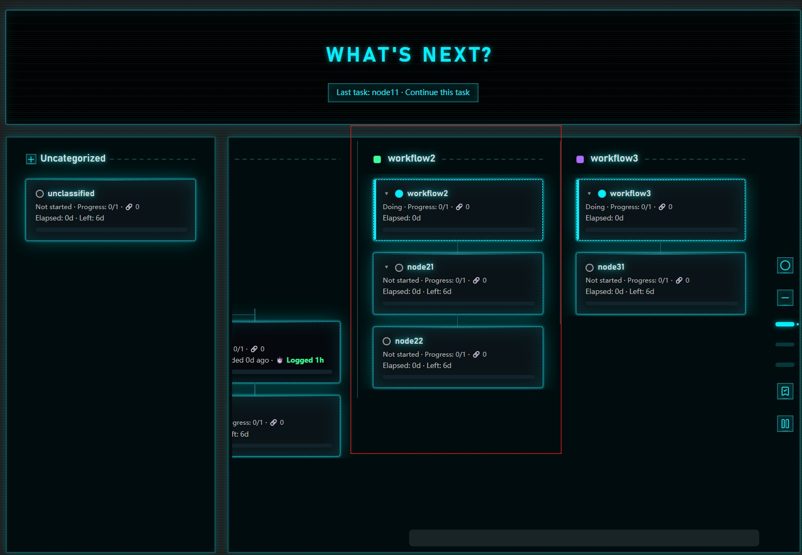

#### 进行中/完成/取消三种状态 | 3 Status: In Progress / Done / Cancelled

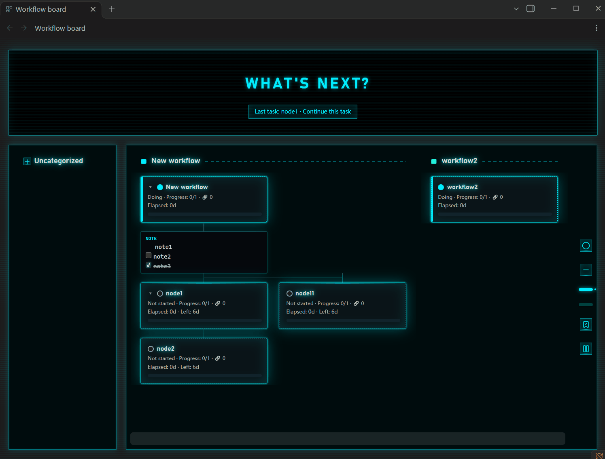

工作流整体拥有三种全局状态：进行中、完成、取消，用于标识整套工作流进度。

Whole workflow has 3 global status: In Progress, Done, Cancelled, to indicate overall progress.

#### 多个工作流展示在一个看板 | Multiple workflows on one dashboard

单看板支持同时承载多条独立工作流，统一查看、管理多套流程。

Single dashboard can host multiple independent workflows for unified view & management.

#### 灵活的导入/导出结构 | Flexible import & export structure

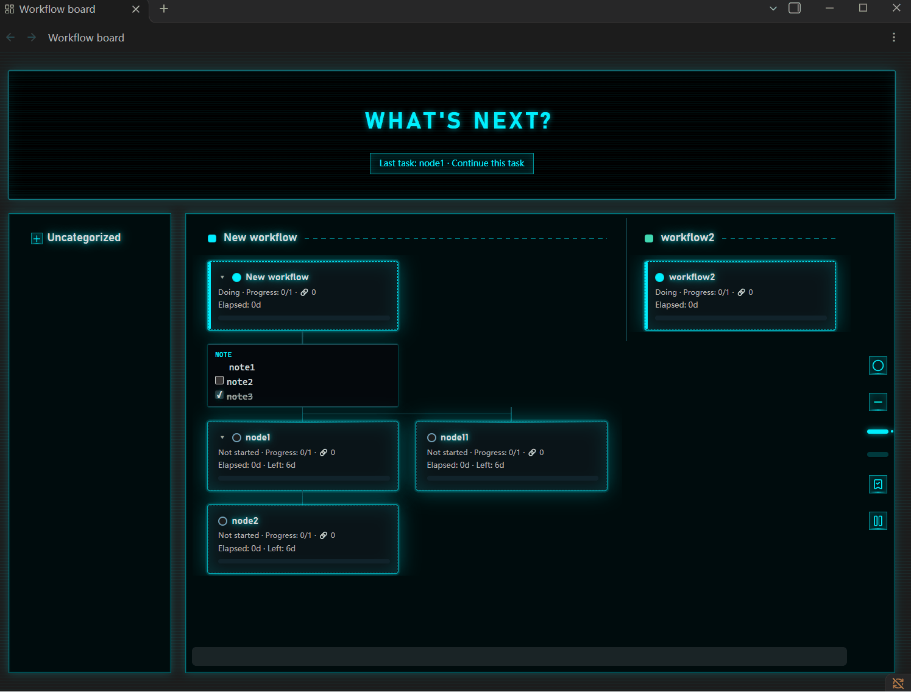

支持整套工作流数据导入导出，方便备份、迁移与共享工作流配置。

Support full workflow import & export for backup, migration and configuration sharing.

#### 额外的无工作流属性的节点 | Extra non-workflow node

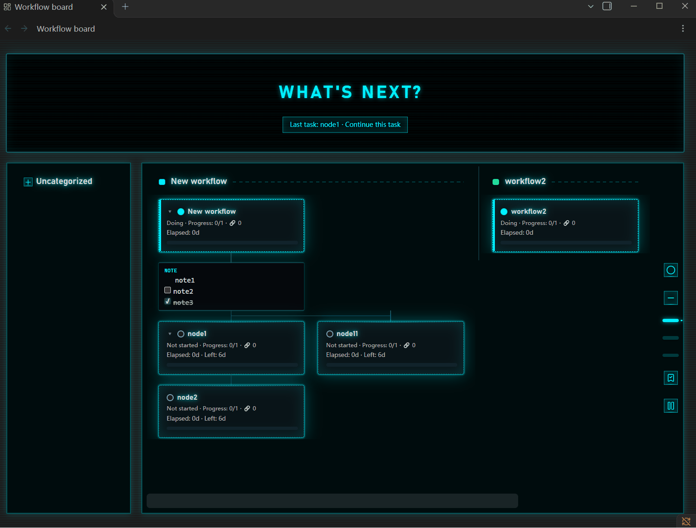

允许添加独立节点，该节点不属于任何工作流，用于存放零散任务、临时事项。

Allow standalone nodes not belonging to any workflow for loose tasks and temporary items.

#### 添加概要/想法/回顾/tag | Add summary / idea / review / tag

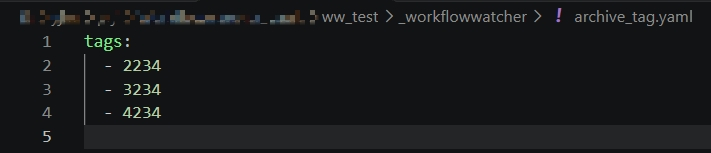

为工作流添加概要描述、想法记录、阶段回顾，支持标签tag标记分类。

Add summary, idea records, phase review and tags for workflow classification.

### 工作流节点 | Workflow Node

#### 卡片 | Card

每个工作流节点以卡片形式展示，作为任务最小操作单元。

Each workflow node displayed as a card, serving as the minimal task unit.

#### 未开始/进行中/完成/受阻/取消五种状态样式 | 5 Status Style: Todo / In Progress / Done / Blocked / Cancelled

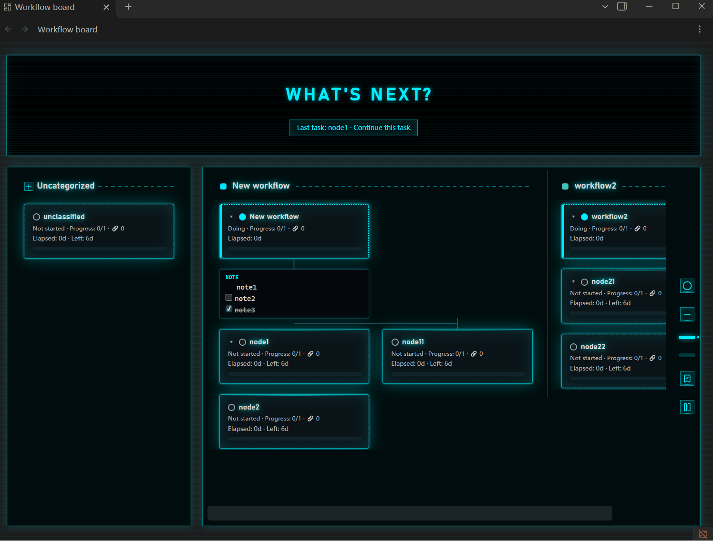

节点卡片内置5种状态样式：未开始、进行中、完成、受阻、取消，不同状态区分视觉样式。

Node card includes 5 visual status: Todo, In Progress, Done, Blocked, Cancelled.

#### 折叠子树 | Collapse subtree

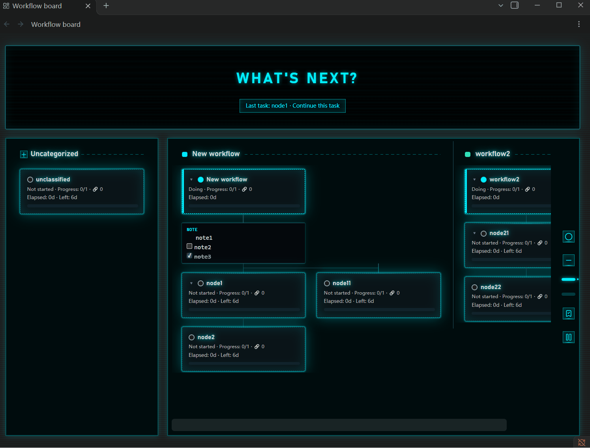

支持折叠/展开当前节点下全部子节点，简化视图，聚焦当前层级。

Collapse / expand all child nodes under current node to simplify view and focus.

#### 进度条（填写分子与分母） | Progress bar (numerator & denominator)

节点支持设置分子、分母数值，自动渲染进度条展示任务完成比例。

Set numerator and denominator to auto render progress bar for completion ratio.

#### 自动填写开始与截止日期（默认一周） | Auto fill start & due date (default 1 week)

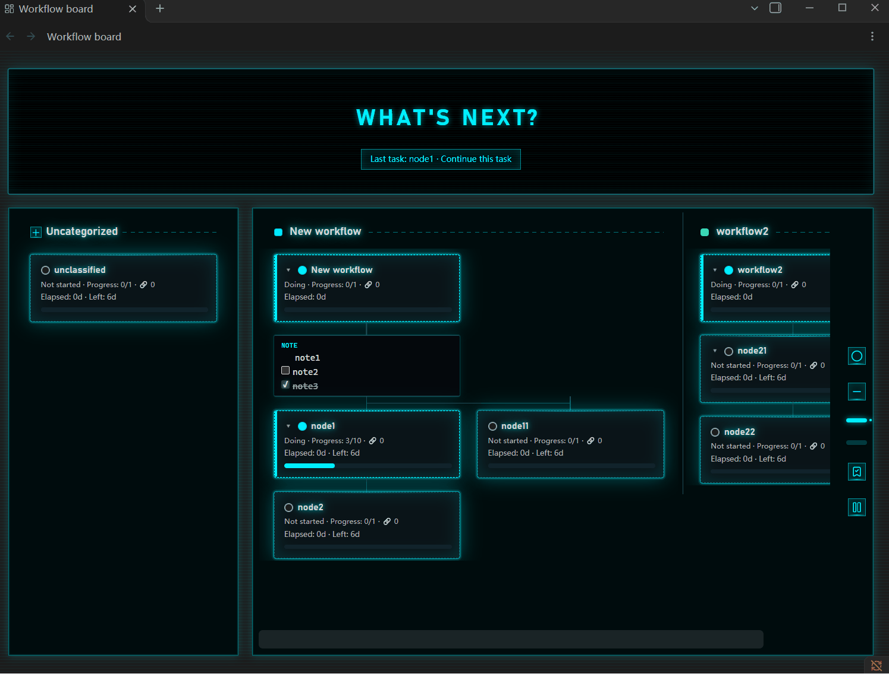

新建节点可自动填充开始日期与截止日期，默认周期为一周，支持手动修改。

New node auto fills start and due date with default 1-week duration, editable manually.

#### 基于yaml标签添加链接文件 | Link files via yaml tags

Add file:

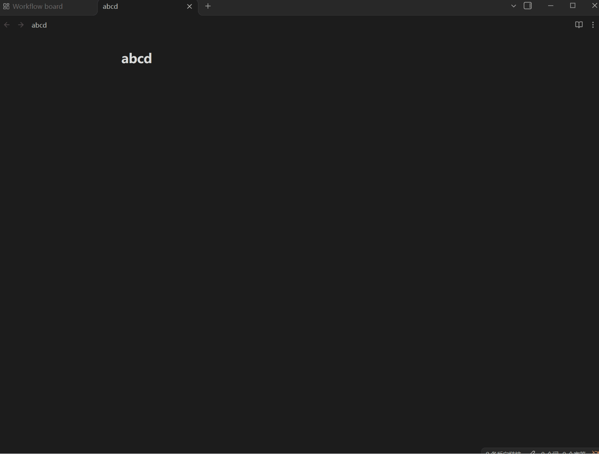

Quick edit file:

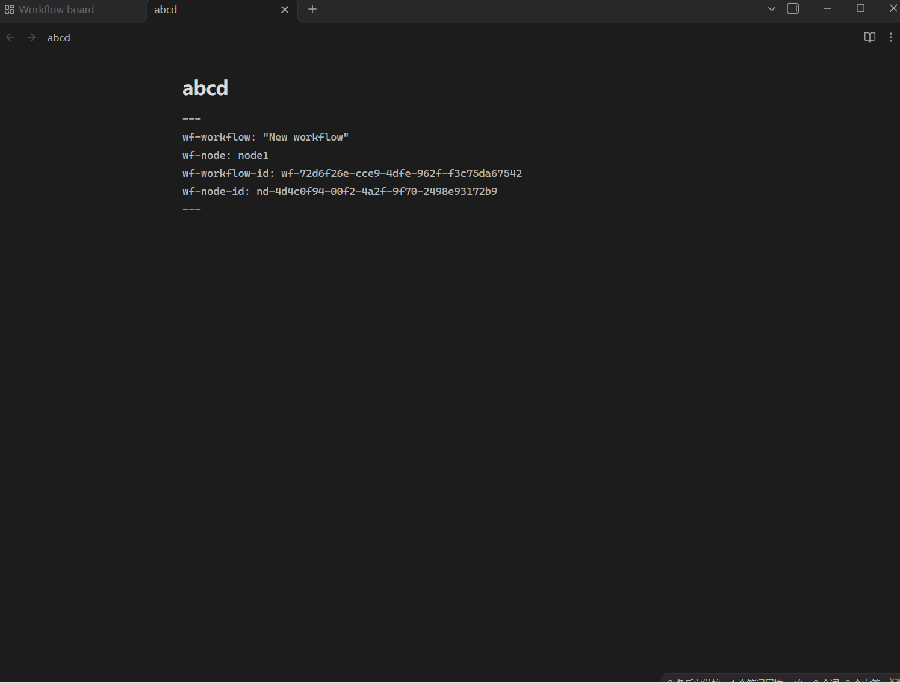

New file:

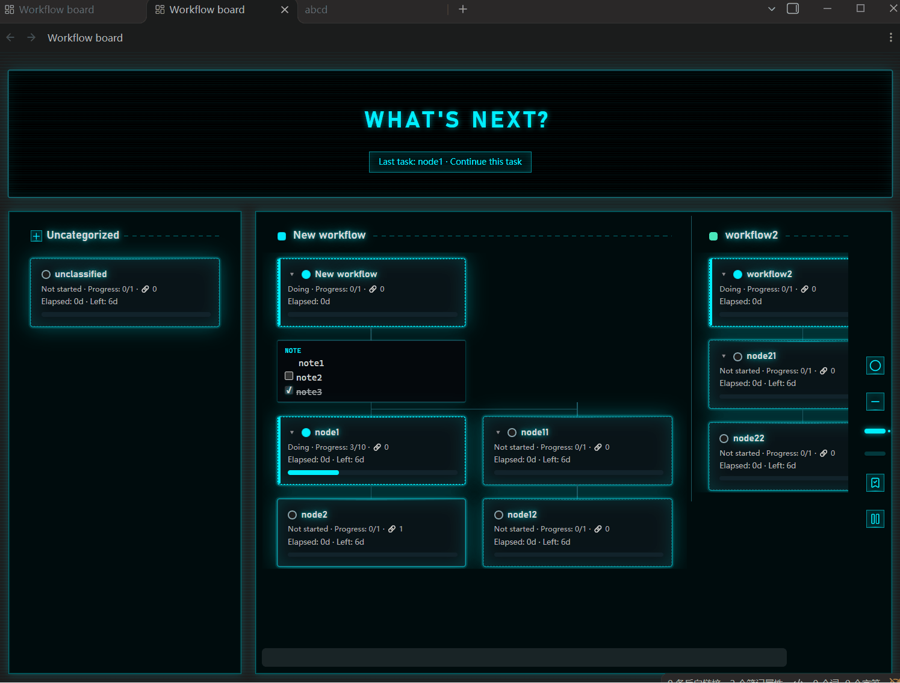

利用YAML表头信息筛选关联的文档文件，快速检索链接资源。节点筛选链接文档有两步，第一步筛选`wf-workflow-id`&`wf-node-id`；第二步筛选`wf-node`&`wf-workflow`。
Filter linked documents using YAML frontmatter for fast resource lookup.
Node filtering for linked documents consists of two steps:
Step 1: Filter by `wf-workflow-id` & `wf-node-id`
Step 2: Filter by `wf-node` & `wf-workflow`

#### 正计时器记录专注时间 | Positive timer for focus time

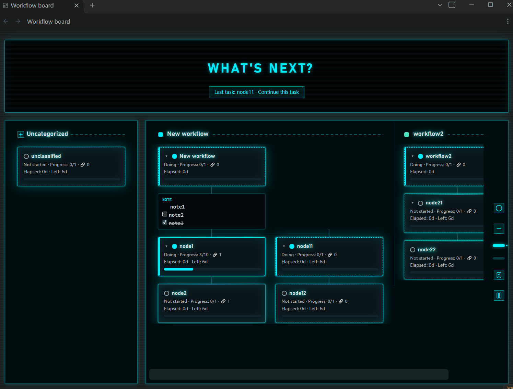

节点内置正向计时器，启动后持续记录该任务的专注时长。

Built-in positive timer to continuously record focus duration of task once started.

#### 显示专注时间 | Display focus time

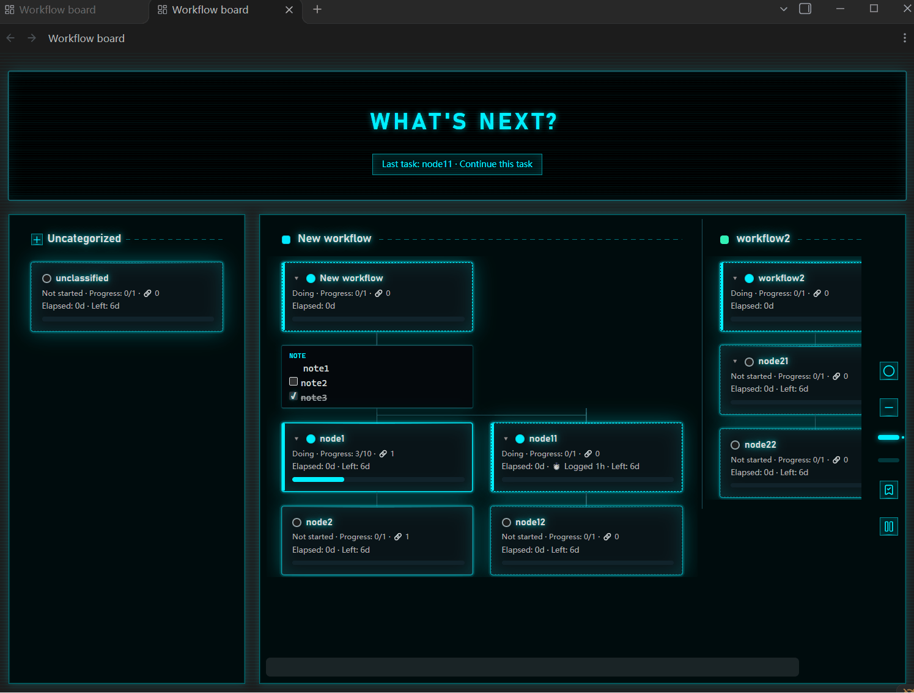

卡片上直接展示该节点累计专注时间。

Show accumulated focus time directly on task card.

#### 生成热力图/甘特图 | Generate heatmap / Gantt chart

基于节点时间、专注时长数据，自动生成热力图与甘特图。

Auto generate heatmap and Gantt chart based on time and focus duration data.

#### 查看重要-紧急四象限 | View Eisenhower Matrix

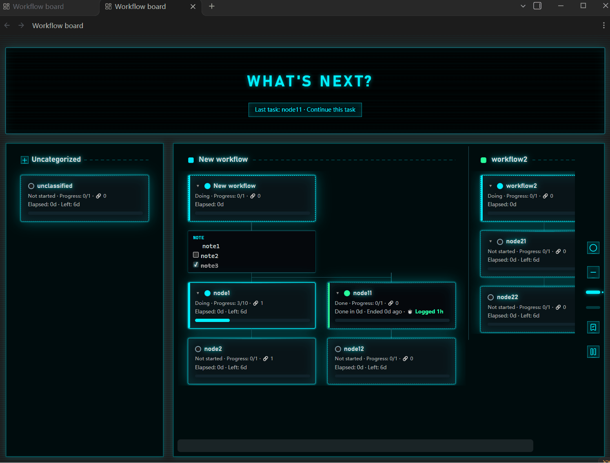

支持切换四象限视图，按重要、紧急维度对当前节点进行归类查看。

Toggle Eisenhower Matrix view to categorize nodes by importance and urgency.

#### 为每个节点添加备注与待办 | Add notes & todos for each node

每个卡片节点可独立添加备注内容，以及内嵌子待办清单。

Each card can add independent notes and embedded sub todo lists.

#### 将已完成子树归档到新看板 | Archive completed subtree to new dashboard

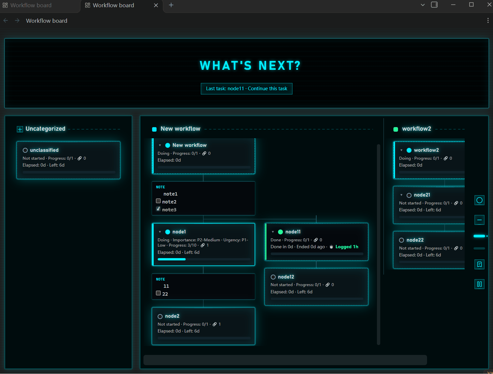

完成的子任务树可以一键归档，迁移至全新看板保存，不干扰当前看板。

One-click archive completed subtree into new dashboard without affecting current view.

#### 拖动卡片修改节点顺序 | Drag card to reorder nodes

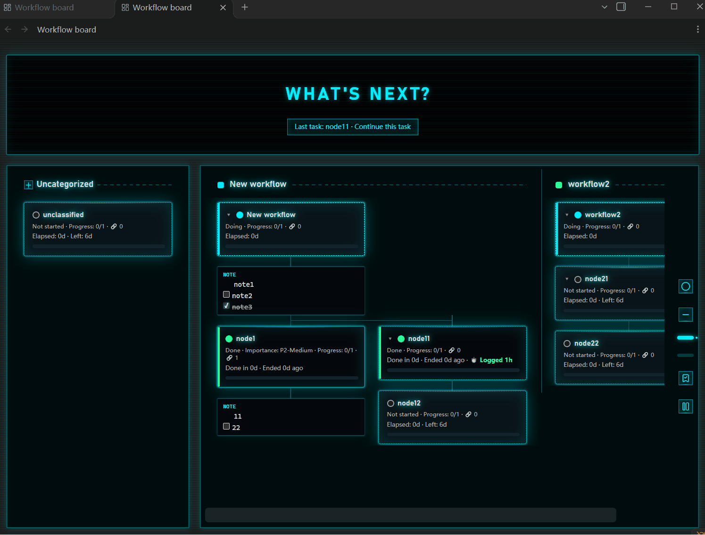

支持拖拽卡片，自由调整节点排序与层级关系。

Drag cards freely to adjust node order and hierarchy.

## 功能 | Features

### 主题 | Theme

#### 深色/浅色 | Dark / Light

基础明暗主题切换，深色模式、浅色模式一键切换。

Basic light/dark mode toggle with one-click switch.

#### 默认/科技/自然/杂志/复古/波点/网页/清新/少女9种主题 | 9 themes: Default / Tech / Nature / Magazine / Retro / Dots / Web / Fresh / Sweet

内置9套风格主题：默认、科技、自然、杂志、复古、波点、网页、清新、少女，一键切换界面样式。

9 built-in themes: Default, Tech, Nature, Magazine, Retro, Dots, Web, Fresh, Sweet for one-click UI switch.

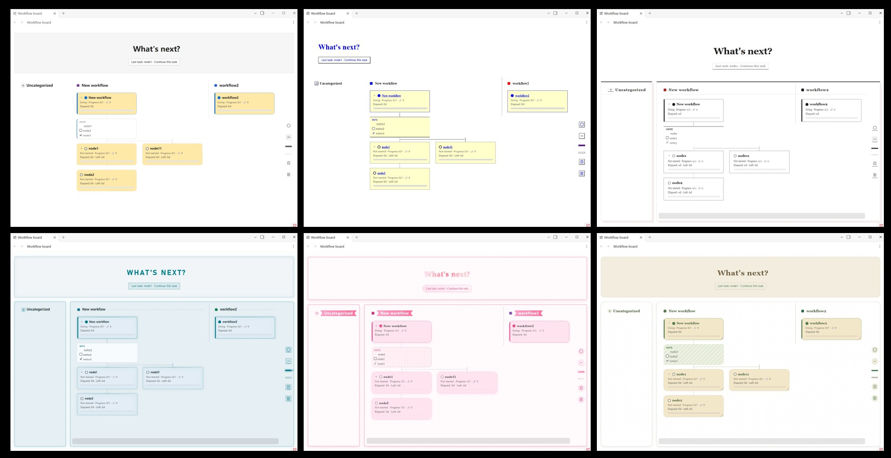

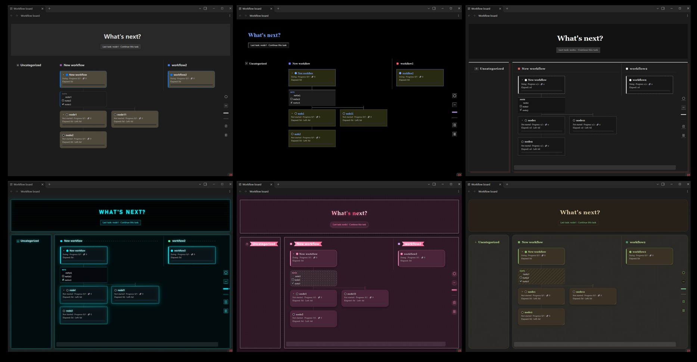

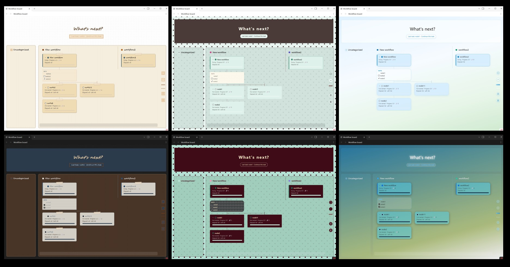

### 灵活 | Flexibility

#### json记录工作流结构 | JSON stores workflow structure

底层使用JSON存储整套工作流的树形结构数据。

Underlying tree structure of workflow stored in JSON format.

**main board path**: yourvault/_workflowwatcher/main~uid.wf.json

**other board path**: yourvault/_workflowwatcher/archive/workflowname-nodename-addtime~uid.wf.json

#### 一个json文件是一个看板 | One JSON file = one dashboard

看板与JSON文件一一对应，单JSON代表一块独立看板。

One JSON file maps to one independent dashboard.

### 专注 | Focus

#### 引导性标题 | Guiding title

展示引导标题，帮助聚焦任务目标。

Show guiding title to help concentrate on task goals.

#### 开启节点正计时器 | Start node focus timer

选中节点即可启动内置正向专注计时器。
Select node to activate built-in positive focus timer.

### 日程 | Schedule

#### 重要-紧急四象限视图 | Eisenhower Matrix view

**入口**：

`导航条上的⚪` > `统计` > `4象限节点`

`⚪ on the navigation bar` > `statistics`>`4 quadratic nodes`

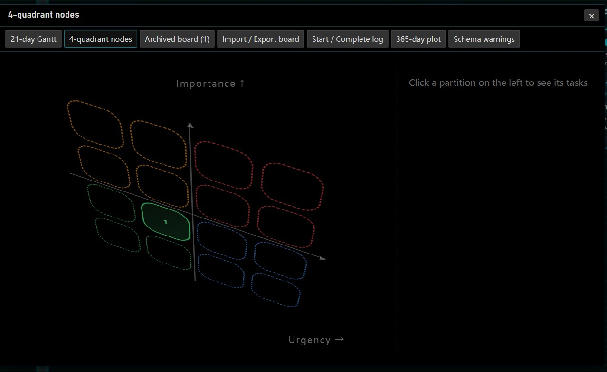

日程视图支持四象限看板，区分重要紧急任务。

Schedule view supports Eisenhower Matrix dashboard to distinguish important & urgent tasks.

#### 开始/完成日志 | Start / completion log

自动记录节点开始、完成操作，生成操作日志。

Automatically log node start and completion actions.

### 统计 | Statistics

#### 绘制日期-数据CSV折线图 | Plot date-data CSV line chart

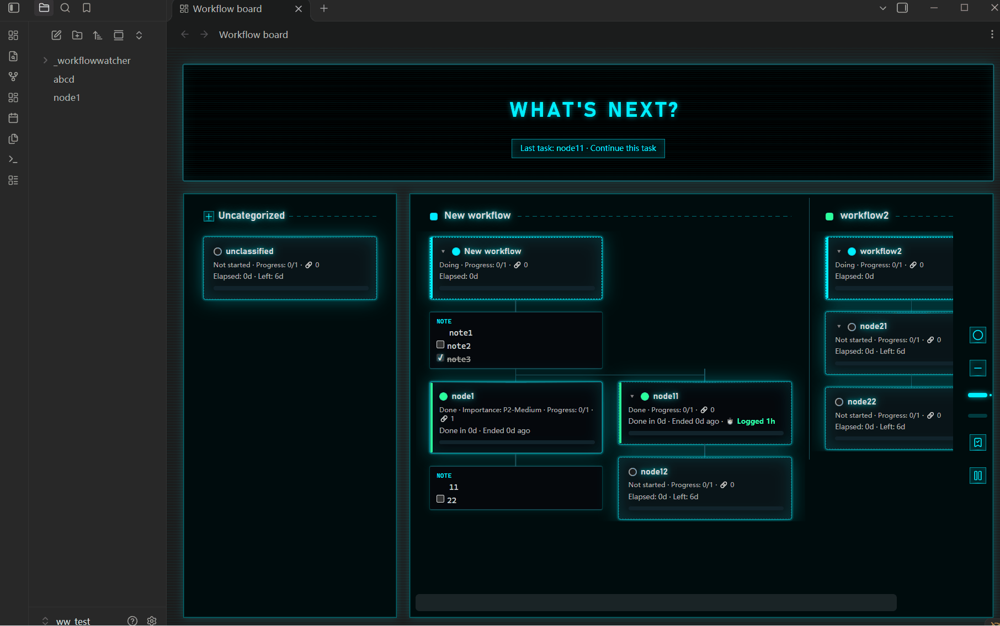

可导出CSV时间数据，并基于日期维度绘制折线图，查看趋势。

Export time data as CSV and plot line chart by date to view trends.

## 快速开始 | Quick Start

### 开启看板 | Open Dashboard

#### 打开看板 | Load dashboard

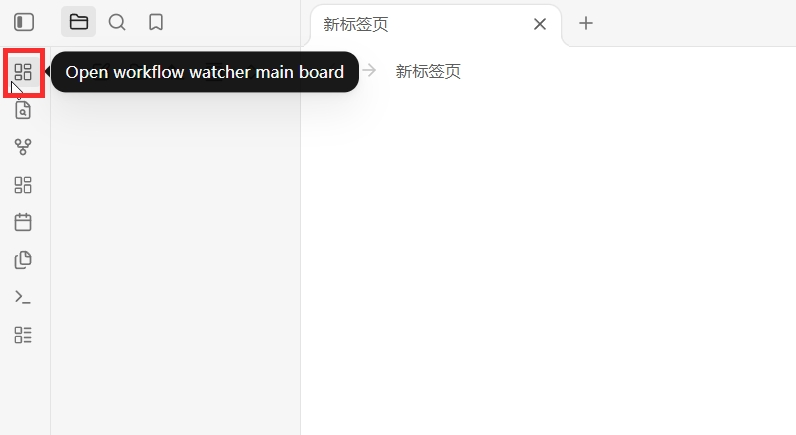

OR

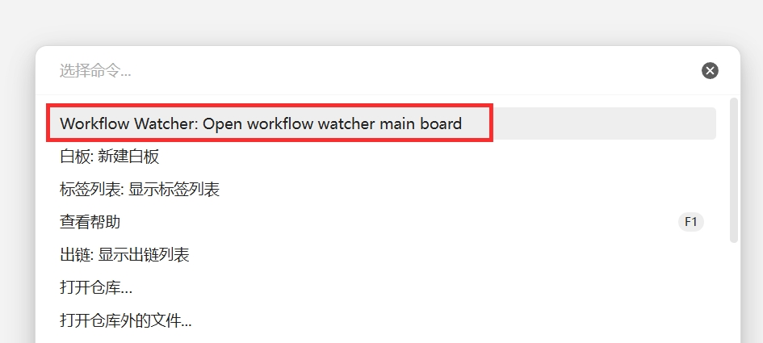

#### 新建工作流 | New workflow

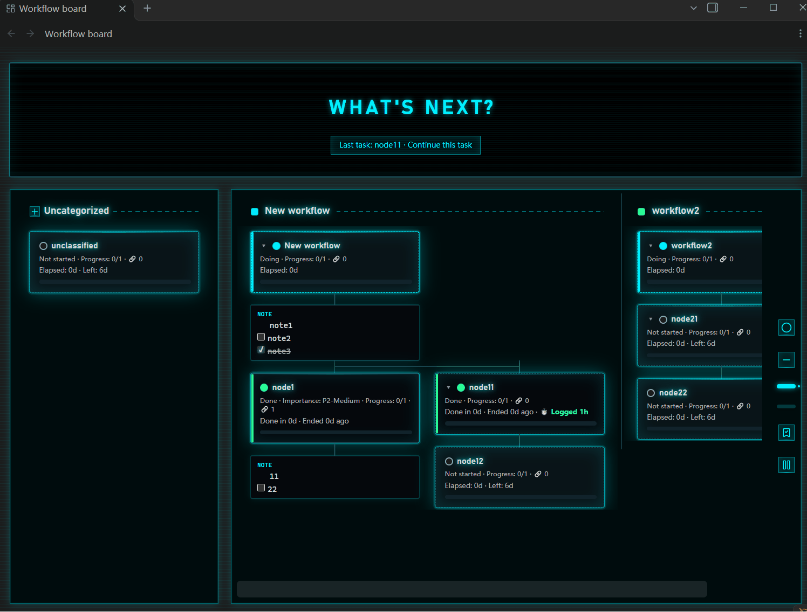

在看板内创建全新工作流，生成根流程节点。

Create new workflow and generate root workflow node inside dashboard.

#### 新增节点 | Add node

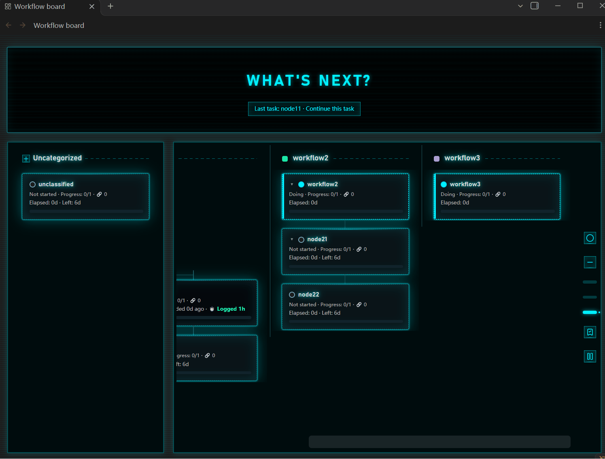

在工作流下添加子任务节点卡片。

Add child task node card under workflow.
